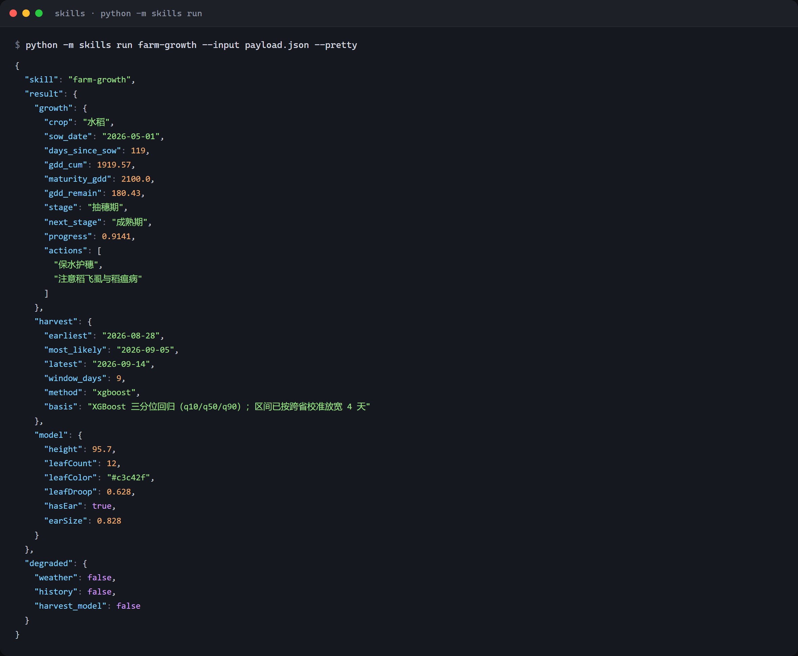
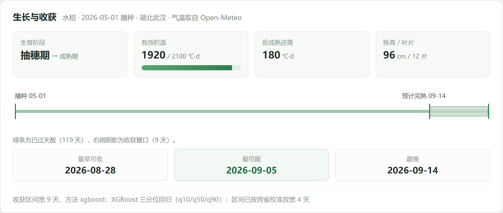

# farm-growth · 农田生长、收获预测与三维参数

从「田头农技台」抽出的一个技能包。由田块、播种日期与逐日气温算出有效积温、生育阶段、
收获日期区间，并给出可直接渲染的三维植株形态参数。

**纯函数路径**：不登录、不读数据库。气温可以直接注入；不注入但给了经纬度就联网取；
两者都没有则返回完整结构并标记降级，不编造收获日期。

`SKILL.md` 是给 AI Agent 读的技能说明，`handler.py` 是可执行实现。

## 能做什么

| 能力 | 返回字段 | 说明 |
|---|---|---|
| 积温与阶段 | `growth` | 按作物参数累计有效积温，给出当前生育阶段、下一阶段与进度 |
| 农事提示 | `growth.actions` | 随阶段变化的当季农事要点 |
| 收获区间 | `harvest` | 三分位回归给 q10 / q50 / q90，即最早、最可能、最晚三个日期 |
| 收割建议 | `harvest_advice` | 结合完熟度与未来降雨给出「雨前抢收」「已完熟，准备收割」一类判断 |
| 三维参数 | `model` | 株高、叶片数、叶色、叶片下垂度、穗大小、干叶比例等，可直接喂渲染器 |
| 气温获取 | `weather` | 给定经纬度取历史与预报；也可整段注入，供离线复算 |

一行输入即可跑通：作物、播种日期、经纬度。

## 实际运行

水稻、2026-05-01 播种、湖北武汉（经纬度联网取气温），把 `today` 定在 2026-08-28：

```bash
python -m skills run farm-growth --input payload.json --pretty
```



同一份返回值画出来是这样：积温 1920 / 2100 ℃·d，抽穗期，窗口宽 9 天。



几个可核对的点：

- `weather.history.rows` 为 120，`source` 为 `fetched`，说明气温是真取回来的，不是占位。
- `harvest.method` 为 `xgboost`，`basis` 写明区间按跨省校准放宽了 4 天；模型缺失时会变成
  `gdd_fallback` 并注明，不会静默降级。
- `model.height` 随进度增长，与前端农田页消费的是同一份结构。

## 文件

| 文件 | 作用 |
|---|---|
| `SKILL.md` | 技能说明：能力范围、输入输出字段、HTTP 与 CLI 用法、降级语义 |
| `handler.py` | 入口 `run(payload, *, allow_paths=True) -> dict` |
| `schemas.py` | `FieldInput` / `WeatherRow` / `ManagementInput` / `FarmGrowthInput` |
| `errors.py` | 技能层异常，由 HTTP 层映射成状态码 |
| `docs/` | 上面两张运行截图 |

## 装配到宿主

```
<repo>/
├── skills/
│   ├── errors.py            # 复制本仓库 errors.py
│   ├── schemas.py           # 把本仓库 schemas.py 的输入模型并进去
│   └── farm_growth/
│       ├── __init__.py      # from . import handler
│       ├── handler.py       # 本仓库 handler.py
│       └── SKILL.md
```

推理侧按需导入宿主的下述模块：

```
src.farm.weather       取 Open-Meteo 气温
src.farm.gdd           有效积温
src.farm.growth        生育阶段
src.farm.stages        作物参数与支持列表
src.farm.harvest_model 收获日期区间
src.farm.advisor       收割建议
src.farm.timeutil      日期工具
```

## 调用

```bash
curl -X POST http://127.0.0.1:8000/api/skills/farm-growth \
  -H "Content-Type: application/json" \
  -d '{
    "field": {"crop":"水稻","sow_date":"2026-05-01","area_mu":1.2,
              "province":"湖北省","city":"武汉市","lng":114.3,"lat":30.58},
    "today": "2026-08-28",
    "history": [{"date":"2026-08-01","tmax":32,"tmin":24},
                {"date":"2026-08-02","tmax":33,"tmin":25}]
  }'
```

CLI：

```bash
python -m skills run farm-growth --input payload.json --pretty
python -m skills run farm-growth --input - --pretty
```

直接调用 handler：

```python
from skills.farm_growth.handler import run

result = run({
    "field": {"crop": "水稻", "sow_date": "2026-05-01"},
    "today": "2026-08-28",
    "history": [{"date": "2026-08-01", "tmax": 32, "tmin": 24}] * 30,
})
print(result["harvest"]["most_likely"])
```

## 三维参数

`model` 与前端农田页消费的是同一份结构，可直接交给 `Farm3D.setModel()`：

```js
const view = Farm3D.create(canvas, { areaMu: () => 1 });
view.setModel(result.model);
```

字段含 `height`、`leafCount`、`leafColor`、`leafDroop`、`stemColor`、`hasEar`、`earSize`、
`earColor`、`earDroop`、`dryLeafRatio`、`hasBlackLayer`、`milkLineGone`。

## 降级语义

- 无 `history` 且无经纬度：`degraded.history = true`，积温为 0，不虚构收获日期。
- 天气接口失败：保留已注入或已缓存的气温，`source_note` 如实说明。
- 收获样本不足：`harvest.method = "gdd_fallback"`，`basis` 注明改用积温法。
- 不支持的作物：返回 400，并列出可选作物。

## 依赖

- Python 3.10+
- pydantic ≥ 2.6
- 运行期由宿主提供：积温与生育阶段模块、收获期模型（XGBoost 分位回归，未安装时回退积温法）、
  天气接口

## 边界

- 收获区间是统计预测，不是承诺；区间宽度与样本量在 `harvest` 里一并给出。
- 导入模型缺权重时不会假装有模型，`method` 字段会写明走的是哪条路径。
